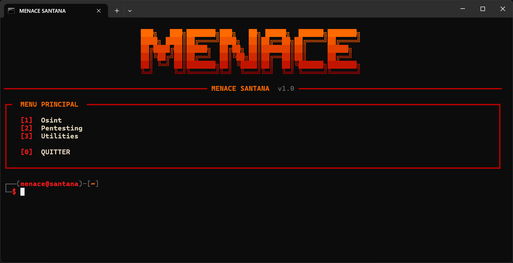

# MENACE SANTANA — Tools




## Installation

```bash
git clone https://github.com/vraibledard/menace-santana-tools.git
cd menace-santana-tools
```

**Windows (recommandé)** : double-clique sur `start.bat`. Le script installe automatiquement les dépendances manquantes (via `install_deps.py`) puis lance l'outil.

**Manuellement** :

```bash
python install_deps.py
python main.py
```

> Prérequis : Python 3.14 ou plus récent.

## Utilisation

```bash
python main.py          # lancement normal, avec l'intro animée
python main.py --fast   # saute l'intro
```

Navigue avec les numéros affichés dans les menus, `0` pour revenir en arrière ou quitter.

## Avertissement

Cet outil est destiné à un usage **légal et éthique**.

- Respecte les conditions d'utilisation des sites interrogés et les lois de ton pays (notamment le RGPD).
- N'utilise pas cet outil pour harceler, traquer ou porter atteinte à la vie privée de quelqu'un.

L'auteur décline toute responsabilité en cas de mauvaise utilisation.

## Crédits

- Développé par : **vraibledard**
- Github : github.com/vraibledard
- Discord : 
- Licence : Licence [MIT](LICENSE.txt)
- Version : V1.0